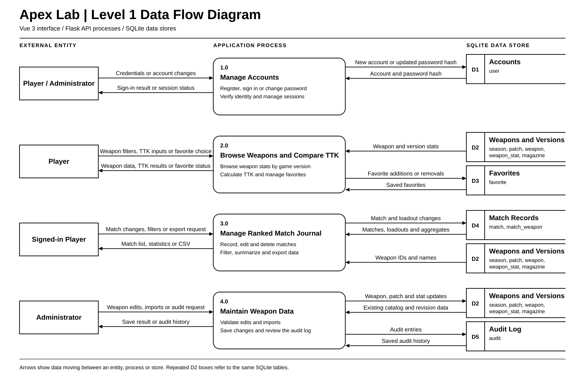
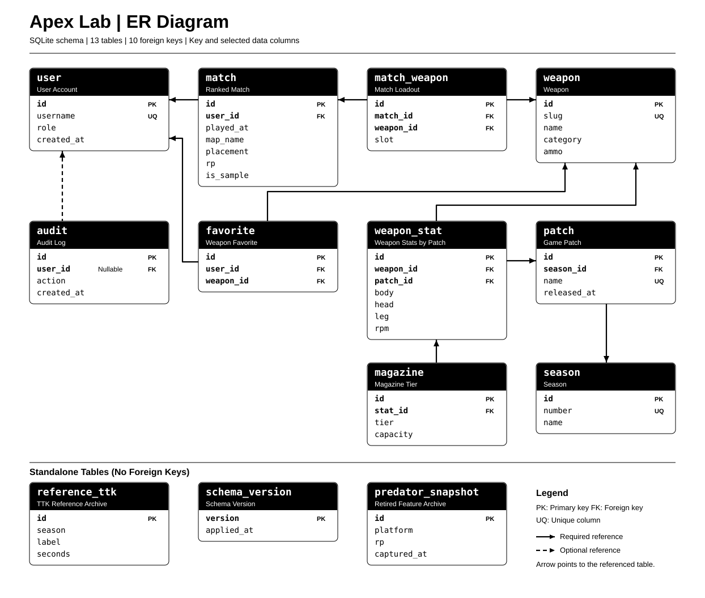

# Apex Lab 数据库设计

Vue 页面通过 Flask API 提交比赛和筛选条件。Flask 将会话中的用户 ID 与日期、地图条件传给 SQLAlchemy，后者向 SQLite 发出查询。SQLite 返回比赛行和分组统计，前端以列表和图表呈现。

## 系统数据流图

[下载一级数据流图（SVG）](data-flow-diagram.svg)

图中四个处理过程对应账号、枪械与 TTK、排位日志、管理员维护。录屏时可以沿 `3.0 Manage Ranked Match Journal` 讲解一条完整的数据流：玩家从 Vue 页面提交比赛或筛选条件，Flask 根据登录账号访问 SQLite 的 `match` 和 `match_weapon` 表，最后将比赛列表、聚合统计或 CSV 返回给页面。多处标为 `D2` 的框表示同一组枪械与版本表。

## ER 图

[下载 ER 图（SVG）](er-diagram.svg)。图依据当前 `instance/apex.db`，展示 13 张实际存在的表、10 条外键，以及各表的主键和代表性字段。`reference_ttk`、`schema_version` 和 `predator_snapshot` 都没有外键。其中 `reference_ttk.season` 存的是赛季编号，SQLite 并未定义它与 `season` 的外键。`predator_snapshot` 是已退役功能留在本地数据库中的历史表。

箭头从包含外键的表指向被引用的表。例如 `match_weapon` 指向 `match` 和 `weapon`。实线表示外键必填，虚线表示外键可空（`audit.user_id`）。主键（PK）和外键（FK）用粗体标出，UQ 表示单列唯一。

## 规范化与约束

- **枪械与版本**。`weapon` 保存枪械名称和类别，`patch` 保存版本名称和所属赛季，`weapon_stat` 通过外键引用两者。`UNIQUE (weapon_id, patch_id)` 保证同一武器在同一版本只有一条参数记录。名称和赛季信息不随每条参数复制，避免修改时出现不一致。
- **比赛与配装**。`match` 保存每场比赛的日期、地图、伤害和积分。`match_weapon` 每个槽位存一行，`UNIQUE (match_id, slot)` 保证一个槽位只有一把枪。枪械名称从 `weapon` 取得，槽位表不重复保存枪械名称或比赛积分。
- **弹匣与收藏**。`magazine` 以 `(stat_id, tier)` 区分同一版本参数下的弹匣等级。`favorite` 以 `(user_id, weapon_id)` 防止重复收藏。删除比赛时，对应槽位记录通过外键级联删除。

这些核心表按第三范式组织。例如在 `match_weapon` 中，`weapon_id` 依赖完整的业务候选键 `(match_id, slot)`，表内没有依赖 `weapon_id` 的枪械名称。在 `weapon_stat` 中，伤害和射速依赖完整的候选键 `(weapon_id, patch_id)`，枪械名称与版本名称分别放在各自实体表里。地图名目前作为比赛属性保存，应用没有需要独立维护的地图属性。

## 示例查询与索引

[sample_queries.sql](sample_queries.sql)覆盖日期筛选、每日 RP 汇总、枪械使用场次和地图表现。枪械查询先对 `(match_id, weapon_id)` 去重，避免同一把枪占两个槽位时重复计算。地图查询先按用户和日期筛选比赛，再用 `GROUP BY map_name` 分组，最后用 `HAVING COUNT(*) >= :min_matches` 筛掉样本不足的地图。

比赛列表按用户过滤、按日期筛选并倒序取最近 50 场，因此使用 `(user_id, played_at)` 联合索引。`user_id` 对应等值条件，`played_at` 对应日期范围。执行 `python scripts/benchmark_match_index.py --rows 100000` 可在相同合成数据上比较执行计划与查询耗时。脚本先预热，再取多次查询的中位数，并校验两次返回的记录完全相同。实验使用内存数据库，结果代表该查询与数据分布下的对比，实际用时会随环境变化。

一次本地测量使用 SQLite 3.35.5、100 个合成账号和 25 次计时。1 万条比赛时，中位数从 0.195 ms 降为 0.014 ms。10 万条比赛时，中位数从 1.917 ms 降为 0.038 ms。两组的执行计划均从全表扫描加临时排序变为通过 `ix_match_user_date` 按用户和日期范围查找。两个规模下，同一规模的有索引和无索引查询分别返回了相同的 18 条和 50 条记录。

## 事务演示

批量导入先校验整批武器参数，再将参数、弹匣和审计记录统一提交。可以在测试环境中准备一个空版本，先提交「一条有效记录 + 一条射速为 0 的记录」，验证参数与审计记录均未新增。修正后重新提交，再检查参数和对应弹匣。`tests/test_system.py` 中的导入测试覆盖失败和成功路径。
